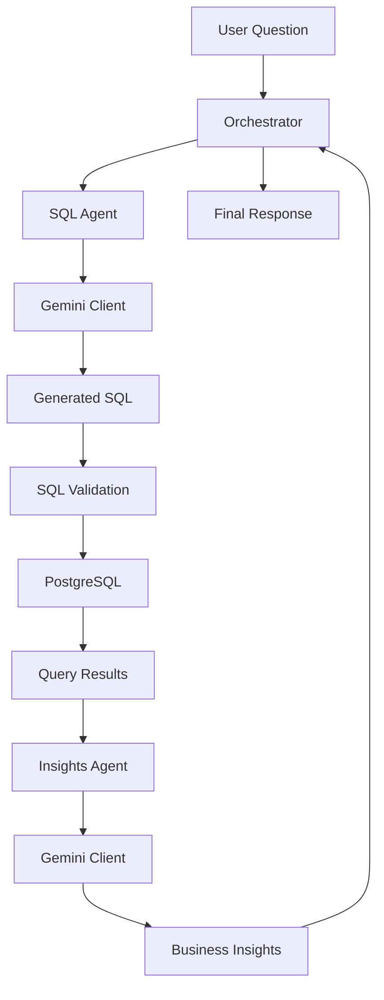

# LumeQuery — AI Agents

## 1. Overview

LumeQuery uses a multi-agent architecture to process natural-language questions and generate business insights from PostgreSQL data.

The AI layer consists of four main components: Gemini Client, SQL Agent, Insights Agent, and Orchestrator.

## 2. Agent Architecture

### 2.1 Gemini Client

**File:** `src/ai/gemini_client.py`

Responsible for communication with the Google Gemini API.

Main responsibilities:

- Initialize the Gemini client using environment variables.
- Send prompts to the configured model.
- Return generated text.
- Retry requests when temporary errors such as HTTP 429 or 503 occur.

### 2.2 SQL Agent

**File:** `src/ai/sql_agent.py`

Responsible for generating, validating, and executing SQL queries based on user questions.

Main functions:

| Function | Responsibility |
|---|---|
| `generate_sql()` | Generates SQL from a natural-language question |
| `validate_sql()` | Validates SQL structure and permitted data sources |
| `execute_sql()` | Executes validated queries against PostgreSQL |
| `run_sql_agent()` | Coordinates the SQL processing steps |

The agent is restricted to the following analytical views:

- `analytics.vw_order_summary`
- `analytics.vw_daily_performance`
- `analytics.vw_restaurant_performance`

SQL validation uses SQLGlot to inspect queries before execution.

### 2.3 Insights Agent

**File:** `src/ai/insights_agent.py`

Responsible for interpreting query results and generating business insights.

Main responsibilities:

- Receive the original question and SQL query results.
- Interpret the returned data.
- Generate concise explanations in natural language.
- Respond in the language identified from the user's question.
- Provide a fallback response when AI requests fail.

The agent uses the Gemini Client to generate its responses.

### 2.4 Orchestrator

**File:** `src/ai/orchestrator.py`

Coordinates the interaction between the SQL Agent and Insights Agent.

The main processing function is `ask_lumequery()`.

It:

1. Receives the user's question.
2. Calls the SQL Agent.
3. Passes the query results to the Insights Agent.
4. Returns the question, generated SQL, row count, and insights.

## 3. Processing Flow

## 4. Response Structure

The Orchestrator returns a structured response containing:

| Field | Description |
|---|---|
| `question` | Original user question |
| `sql` | Executed SQL query |
| `row_count` | Number of returned records |
| `insights` | AI-generated interpretation |

## 5. Testing

The AI components include scripts for manual testing:

- `src/ai/test_connection.py`: checks Gemini API connectivity.
- `src/ai/test_agents.py`: tests the agent workflow.
- `src/ai/test_sql_safety.py`: tests SQL validation behavior.

Automated SQL safety tests are also available in `tests/test_sql_safety.py`.