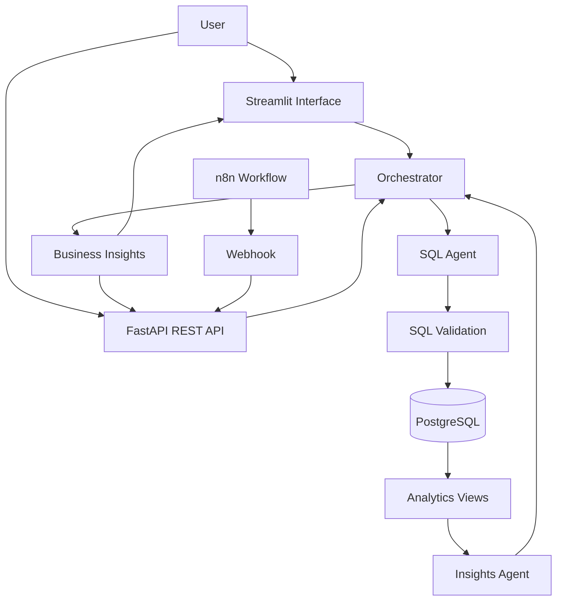

# LumeQuery — Technical Architecture

## 1. Overview

LumeQuery follows a modular architecture that integrates relational data storage, analytical processing, AI agents, application interfaces, and workflow automation.

Its main purpose is to transform natural-language questions into controlled SQL queries, retrieve structured data, and generate business insights.

## 2. Architecture Overview

## 3. Architecture Layers

### 3.1 Data Layer

**Technology:** PostgreSQL

Responsible for storing synthetic marketplace data and providing structured information for analytical queries.

The database is organized into two schemas:

- `raw`: operational source tables.
- `analytics`: analytical views designed for business queries.

The analytical views provide a simplified access layer between operational data and AI-generated queries.

### 3.2 Data Processing Layer

**Technologies:** Python and Pandas

Responsible for synthetic data generation, database connectivity, and analytical processing.

Main modules:

| File | Responsibility |
|---|---|
| `src/database.py` | PostgreSQL connection and data access |
| `src/generate_data.py` | Synthetic data generation |
| `src/generate_orders.py` | Order data generation |
| `src/analyze_data.py` | Data processing and analysis with Pandas |

Analytical outputs are exported as CSV files into the `data/` directory.

### 3.3 AI Layer

**Technology:** Google Gemini API

Responsible for natural-language interpretation, SQL generation, query execution, and business insight generation.

Main components:

| Component | File | Responsibility |
|---|---|---|
| Gemini Client | `gemini_client.py` | Communication with the AI model |
| SQL Agent | `sql_agent.py` | SQL generation, validation, and execution |
| Insights Agent | `insights_agent.py` | Interpretation of query results |
| Orchestrator | `orchestrator.py` | Coordination of the AI workflow |

Each component has a separate responsibility, supporting modularity and maintainability.

### 3.4 Application Layer

**Technologies:** Streamlit and FastAPI

The application provides two access interfaces.

**Streamlit**

Interactive interface for submitting questions, viewing generated insights, inspecting SQL queries, and exploring returned results.

Main file: `app.py`.

**FastAPI**

REST API that exposes the platform's question-answering functionality to external services.

Main file: `api.py`.

Implemented endpoints:

| Method | Endpoint | Description |
|---|---|---|
| GET | `/health` | API health check |
| POST | `/ask` | Processes a natural-language question |

### 3.5 Automation Layer

**Technologies:** n8n and Docker Compose

The automation layer connects LumeQuery to external workflows.

The n8n workflow receives a question through a webhook, forwards it to the FastAPI service, and returns the processed response.

The current environment runs locally using Docker Compose.

## 4. Question Processing Workflow

The processing sequence follows these steps:

1. **Input:** The user submits a natural-language question through Streamlit or the REST API.
2. **Orchestration:** The Orchestrator receives the request and starts the processing workflow.
3. **SQL Generation:** The SQL Agent uses Gemini to generate a PostgreSQL query.
4. **Validation:** SQLGlot checks the query structure and enforces the allowed SQL operations and data sources.
5. **Execution:** Approved queries are executed against authorized PostgreSQL analytical views.
6. **Interpretation:** The Insights Agent receives the query results and generates a natural-language explanation.
7. **Response:** The Orchestrator returns the question, executed SQL, result count, and generated insights.

## 5. Query Security

Because SQL queries are generated by an AI model, a validation layer is implemented before database execution.

Implemented safeguards include:

- Only `SELECT` statements are accepted.
- Access is restricted to authorized analytical views.
- Data modification operations are rejected.
- Multiple SQL statements are rejected.
- Queries are limited to a maximum of 100 records when no limit is specified.
- Database execution uses read-only transactions.
- SQL execution has a 5-second timeout.

These controls provide an additional layer of protection between AI-generated queries and the database.

## 6. Component Communication

| Source | Destination | Communication |
|---|---|---|
| Streamlit | Orchestrator | Python function call |
| FastAPI | Orchestrator | Python function call |
| Orchestrator | SQL Agent | Python function call |
| SQL Agent | Gemini Client | Gemini API request |
| SQL Agent | PostgreSQL | Validated SQL execution |
| Insights Agent | Gemini Client | Gemini API request |
| n8n | FastAPI | HTTP request |
| Python | PostgreSQL | Database connection |

## 7. Design Considerations

The architecture separates responsibilities to simplify maintenance and future development.

- AI agents can evolve independently of the application interfaces.
- The REST API enables integration with external services.
- Analytical views isolate business queries from operational tables.
- Workflow automation can be extended without changing the core agent logic.
- Automated tests help verify API behavior and SQL safety mechanisms.

