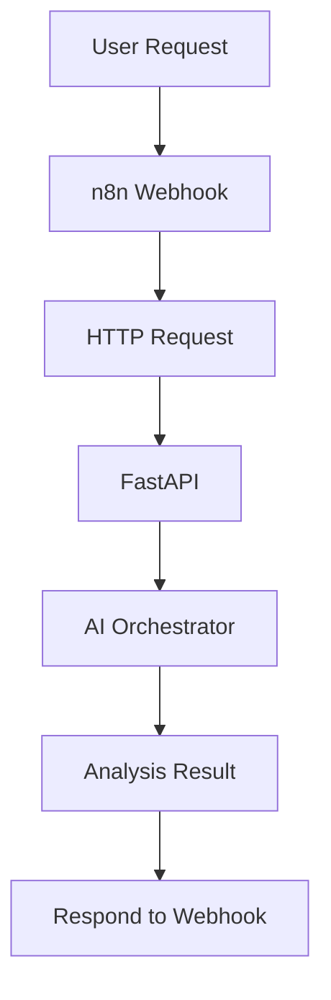

# n8n Integration

## 1. Overview

LumeQuery uses n8n to automate the submission of natural language questions to the AI data analysis API.

The integration runs locally using Docker Compose.

## 2. Workflow Architecture



## 3. Workflow Configuration

The workflow is named `LumeQuery - AI Data Intelligence` and contains three main nodes:

| Node | Configuration |
|---|---|
| Webhook | Receives POST requests at `/lumequery` |
| HTTP Request | Sends the question to the FastAPI `/ask` endpoint |
| Respond to Webhook | Returns the API response as JSON |

The HTTP Request node uses:

- **Method:** POST
- **URL:** `http://host.docker.internal:8000/ask`
- **Body:** JSON
- **Parameter:** `question`

## 4. Local Environment

n8n runs inside a Docker container and exposes its interface at:

`http://localhost:5678`

The FastAPI application runs on the host machine:

```bash
uvicorn api:app --host 0.0.0.0 --port 8000
```

The `host.docker.internal` address allows the n8n container to communicate with the API running on the host.

## 5. Execution Flow

1. A POST request sends a natural language question to the n8n webhook.
2. The Webhook node receives the request.
3. The HTTP Request node forwards the question to FastAPI.
4. FastAPI executes the LumeQuery AI orchestration flow.
5. The API returns the analysis result.
6. The Respond to Webhook node sends the JSON response.

## 6. Running the Integration

Start the n8n container from the project directory:

```bash
docker compose up -d
```

Start the FastAPI application in a separate terminal:

```bash
uvicorn api:app --host 0.0.0.0 --port 8000
```

Both services must be running for the integration to work.

